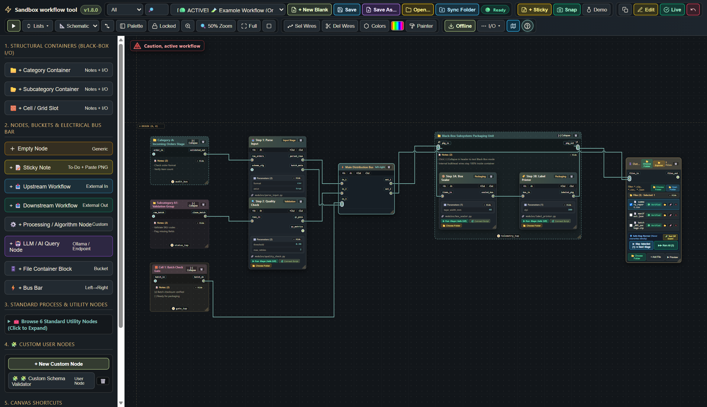

# SandboxWorkflow (`v1.9.1`)

A single-file, zero-dependency, offline visual workflow and schematic node editor.

> SandboxWorkflow is built with gratitude for the inspiration from [ComfyUI](https://github.com/comfyanonymous/ComfyUI) and [LiteGraph.js](https://github.com/jagenjo/litegraph.js), alongside the [Everforest](https://github.com/sainnhe/everforest) color palette and crisp [Lucide](https://lucide.dev/) / [Feather](https://feathericons.com/) inline SVG icons (for icon designs which were used in this UI). Thank you for sharing your creativity and style which inspired the look and feel of this workflow tool!



## Quick Start

1. **Open immediately offline**: Download or open [`dist/SandboxWorkflow_v1.9.1.html`](dist/SandboxWorkflow_v1.9.1.html) directly in any modern browser (`file://`) — no build step, server, or internet connection required.
2. **Rebuild the single-file bundle from source**:
   ```bash
   python scripts/bundle.py
   ```
3. **Run the full test suite** (requires Python 3.10+ and Node.js in `PATH`):
   ```bash
   python -m unittest discover -s tests -p "test_*.py" -v
   ```

## Key Features

- **Single-File Portable Delivery**: Edit modular HTML, CSS, and JavaScript under `src/sandbox_workflow/` and compile everything into one self-contained `dist/SandboxWorkflow_v1.9.1.html` offline bundle.
- **Orthogonal Schematic & Curved Wire Routing**: Interactive multi-port node graph with automatic A* orthogonal wire routing, schematic/curved wire modes, wire-detail toggles, wire painting, selection, and bus bars.
- **Hierarchical Structural Containers**: Collapse complex multi-node stages into Black-Box structural containers (`Category`, `Subcategory`, and `Cell` slots) with bulkhead I/O ports, internal hub wires, and automated boundary guards.
- **File Containers, Sticky Notes & Snapshots**: Embed file pattern containers, markdown/PNG sticky notes, custom user nodes, and side-by-side workflow snapshot diffs.
- **Example Workflows Included**: Ships with [`examples/data_pipeline_starter.workflow.json`](examples/data_pipeline_starter.workflow.json) and [`examples/etl_multi_stage_demo.workflow.json`](examples/etl_multi_stage_demo.workflow.json) plus built-in starter workflows.

## Repository Layout

```text
SandboxWorkflow/
├── LICENSE                          # Apache License 2.0
├── NOTICE                           # Original-work & inspiration attributions
├── README.md                        # Project overview & quick start
├── AGENTS.md                        # Contributor & AI-agent guardrails
├── docs/screenshot.png              # UI screenshot
├── dist/SandboxWorkflow_v1.9.1.html # Compiled single-file offline bundle
├── examples/                        # Starter .workflow.json files
├── scripts/bundle.py                # Zero-dependency single-file bundler
├── src/sandbox_workflow/
│   ├── template.html                # HTML layout & inline SVG icons
│   ├── styles.css                   # Everforest-inspired dark theme CSS
│   └── app.js                       # Canvas, A* router, & workflow state
└── tests/test_sandbox_workflow.py   # Offline unit & JS syntax checks
```

## Contributor Workflow

See [`AGENTS.md`](AGENTS.md) for source-first rules (`src/sandbox_workflow/` -> `python scripts/bundle.py` -> `python -m unittest`). Never hand-edit the compiled `dist/` bundle directly; always rebuild from `src/` so the bundle and tests stay in sync.

## Supporting This Project

If you find SandboxWorkflow useful, please open bug reports, workflow ideas, or pull requests via **GitHub Issues**.

## License & Acknowledgments

- **License**: Licensed under the **Apache License, Version 2.0** — see [`LICENSE`](LICENSE) and [`NOTICE`](NOTICE).
- **Attribution & Third-Party Notices**: SandboxWorkflow's canvas engine, orthogonal A* wire router, and offline bundler are original Apache-2.0 works with **zero third-party runtime dependencies**; adapted Everforest palette colors (`MIT`) and inline `24x24` SVG toolbar icons from Feather (`MIT`) and Lucide (`ISC`) are credited in [`NOTICE`](NOTICE) alongside design inspiration from ComfyUI and LiteGraph.js.
